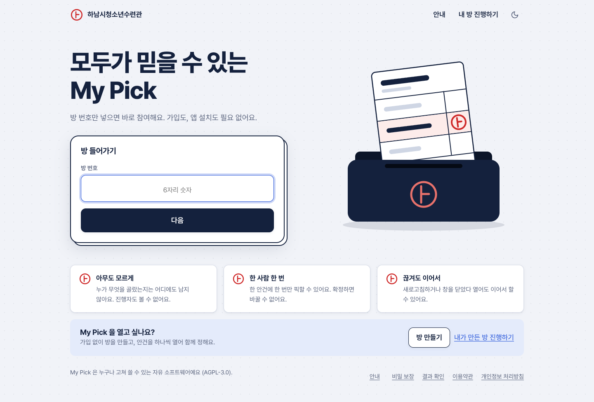
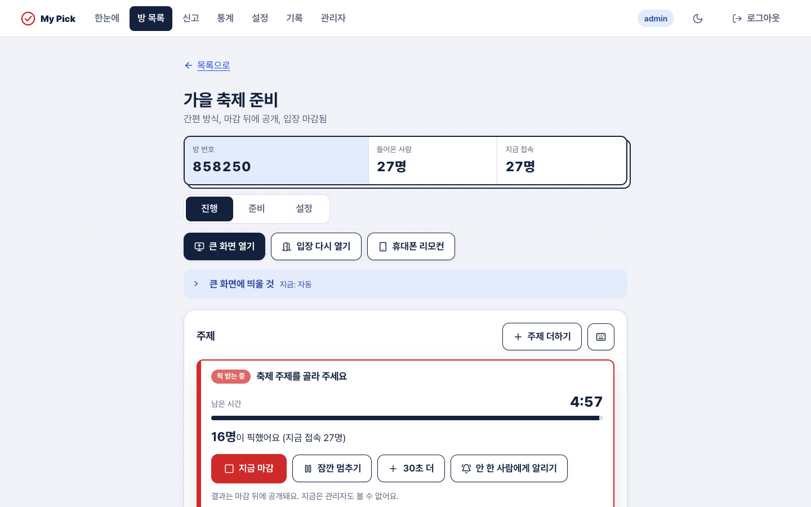
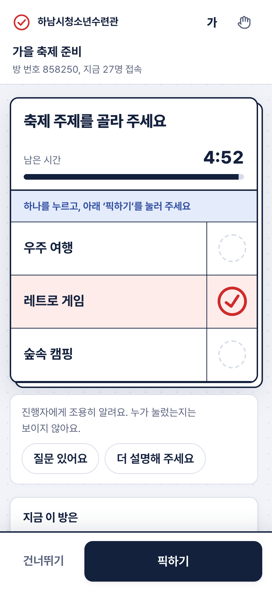
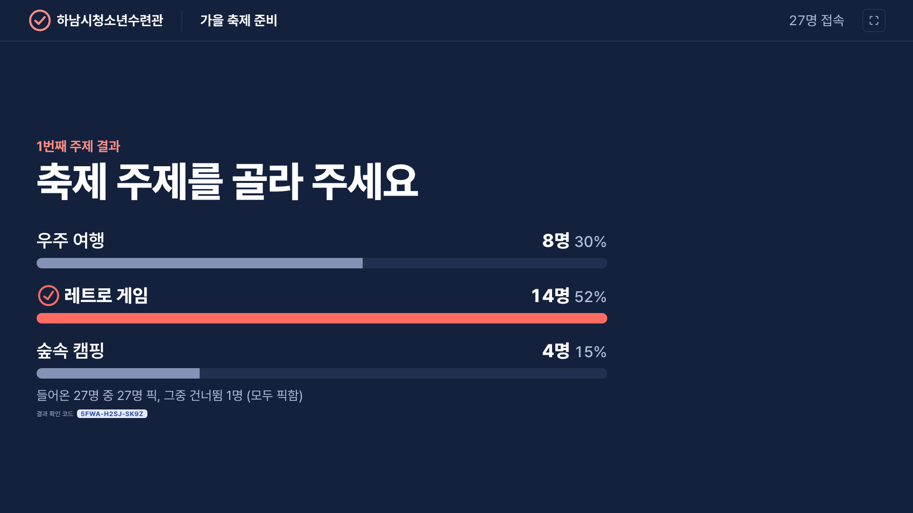
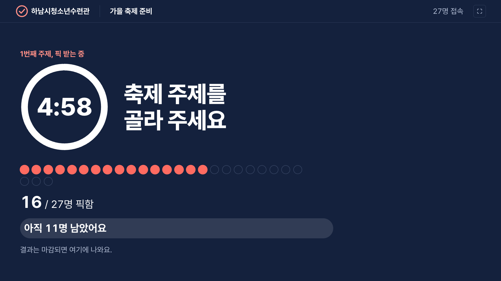
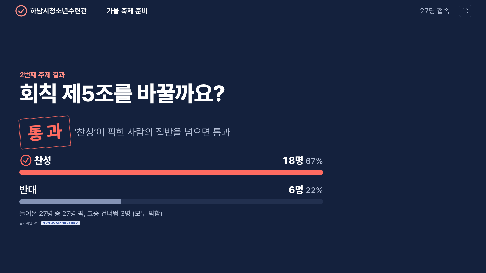

<div align="center">


# My Pick

**방 번호 하나로 모여, 함께 고르고, 결과를 같이 봐요.**

가입도 앱 설치도 없이 휴대폰으로 참여하는 익명 픽 서비스예요.
누가 무엇을 골랐는지는 어디에도 남지 않아요.

[](LICENSE)




</div>

> **지금 버전은 1.0.2 예요.** 카카오톡으로 주소를 보낼 때 미리보기 그림이 떠요. 1.0.1 에서는 100명 · 1000명 · 2000명 모의 진행과 공격 시험으로 찾은 문제를 고치고, 끝내는 버튼과 맨 아래 칸을 다듬었어요. 바뀐 것은 [CHANGELOG.md](CHANGELOG.md) 에 있어요.

## 이렇게 써요

| 1. 방을 만들어요 | 2. 다 같이 골라요 | 3. 결과를 함께 봐요 |
|:---:|:---:|:---:|
|  |  |  |
| 방 번호 6자리가 나와요.<br/>주제를 하나씩 열어요. | QR 을 찍고 들어와<br/>픽 카드에 도장을 찍어요. | 마감되면 모든 화면에<br/>한꺼번에 나와요. |

<div align="center">


</div>

## 무엇이 되나요

**참여하는 사람**
- 방 번호(또는 QR)만으로 참여, 새로고침해도 이어서
- 카카오톡 · 메신저로 주소를 보내면 미리보기 그림과 소개 글이 떠요
- PC · 휴대폰 · 태블릿 화면, 어두운 화면, 한 손 모드, 글자 크기, 쉬운 말 모드
- 기다리는 동안 진행 상황, 조용한 손들기(누가 눌렀는지 모르게), 마감 뒤 익명으로 확인 요청 보내기
- 방에 있는 동안 화면이 꺼지지 않게, 처음 쓰는 사람을 위한 이용 가이드(`/guide`)

**진행하는 사람**
- 가입 없이 방 만들기, 주제를 하나씩 열고 마감, 예약 열기 · 예약 마감
- 큰 화면(남은 시간 · 참여 현황 · 결과, 선택지 30개까지 한 화면에), 휴대폰 리모컨(지금 마감 · 방 끝내기까지), 리허설(가짜 참여자 10명), PC 단축키
- 잠깐 멈추기(남은 시간을 얼리고 설명), 시간 늘리기, 손든 사람 알림
- 여러 개 고르기, 통과 기준과 최소 참여 인원, 동점 다시 고르기, 선택지 순서 섞기
- 결과 내려받기(CSV) · 인쇄 · 결과 정리 · 결과 그림(PNG), 주제 묶음, 공동 진행자, 지켜보기 주소(큰 화면 모드)
- 한 번만 쓰는 입장 코드와 ‘다시 열기’

**운영하는 사람**
- 한눈에 보기, 통계, 방 찾기 · 복제 · 보관, 신고 · 막을 낱말 · 막기
- 관리자 여러 명, 열쇠로 봉한 기록과 기록 지문, 하루 한 번 백업과 되돌리기, 오류 제보함
- 학교처럼 모두 같은 접속 주소를 쓰는 곳에서도 몇 명의 실수로 전체가 잠기지 않게, 틀린 횟수를 기기마다 따로 세요

## 믿을 수 있게

| 약속 | 어떻게 |
|---|---|
| 누가 무엇을 골랐는지 아무도 몰라요 | ‘누가 참여했는지’와 ‘무엇이 몇 명인지’를 따로 저장하고, 고른 것은 하나하나 남기지 않고 숫자만 올려요 |
| 한 사람 한 번 | 서버가 막아요. 더 엄격하게는 1인 1입장코드 |
| 엿볼 수 없어요 | 마감 전에는 진행자 · 관리자도 결과를 못 봐요. 픽이 열려 있는 동안에는 백업도 만들거나 내려받을 수 없어요 |
| 바꿔치기할 수 없어요 | 한 번 연 주제는 고칠 수 없고, 마감 때 만든 **결과 확인 코드**로 누구나 결과가 그대로인지 확인해요 |
| 진행자가 한 일이 남아요 | 앞뒤가 이어진 기록을 `.env` 의 열쇠로 봉해요. 중간을 고치거나 끝을 잘라 내면 드러나고, 기록 지문을 밖에 적어 두면 나중에 견줄 수 있어요 |
| 바깥으로 새지 않아요 | 광고 · 통계 · 글꼴 서버를 부르지 않아요. 이름 · 연락처를 받지 않아요 |

자세한 내용과 한계는 서비스의 `/guide` · `/privacy` 에 있어요.

## 바로 띄우기

Docker 만 있으면 돼요. [Releases](https://github.com/hatility/My-Pick/releases) 의 `my-pick-v1.0.2.zip` 을 받아 풀거나, 저장소를 받아요.

```bash
git clone https://github.com/hatility/My-Pick.git
cd My-Pick
cp .env.example .env        # 아래 ‘정식으로 운영하기 전에’ 의 네 가지를 정해 주세요
docker compose up -d --build
```

**정식으로 운영하기 전에** `.env` 에서 꼭 정해 주세요.

1. `ADMIN_PASSWORD`: 관리자 비밀번호 (8자 이상)
2. `CONTACT`: 운영하는 곳의 연락처. 개인정보 처리방침의 ‘개인정보 보호책임자 · 문의’ 에 나와요
3. `AUDIT_SECRET`: 기록을 봉하는 열쇠 (`openssl rand -hex 32`). 백업과 함께 안전한 곳에 적어 두세요
4. 밖에서 쓸 때는 `SITE_URL` · `DOMAIN` 을 넣고 HTTPS 로 띄우기 (아래). `SITE_URL` 은 카카오톡에 주소를 보낼 때 뜨는 미리보기 그림 주소에도 쓰여요

| 주소 | 무엇 |
|---|---|
| http://localhost:8082 | 참여하기 (휴대폰 · 태블릿은 `/m` 으로 넘어가요) |
| http://localhost:8082/new | 방 만들기 |
| http://localhost:8082/admin | 관리자 |
| http://localhost:8082/guide | 이용 가이드 (참여하기 · 진행하기) |

밖에서 쓸 때는 HTTPS 로 띄워 주세요: `.env` 에 `DOMAIN` · `SITE_URL` 을 넣고
`docker compose -f docker-compose.yml -f app/docker-compose.https.yml up -d --build`

### 백업 · 되살리기 · 새 버전으로 올리기

```bash
./backup.sh                      # 서버를 멈추지 않고 backups/mypick-날짜.db 로 사본
./restore.sh backups/mypick-….db # 그 사본으로 되살리기 (새 서버로 옮길 때도). 바꾸기 전 파일은 볼륨 안에 남아요
```

서버도 하루 한 번 스스로 백업하고, 관리자 화면 ‘설정 → 백업’ 에서 내려받거나 되돌릴 수 있어요.
새 버전으로 올릴 때는 `./backup.sh` 를 한 번 한 뒤, 새 폴더에 지금 `.env` 를 옮기고 `docker compose up -d --build` 하면 돼요 (저장 파일은 Docker 볼륨 `my-pick_mypick-data` 에 그대로 있어요).

## 설정 (`.env`)

| 이름 | 기본값 | 무엇 |
|---|---|---|
| `ADMIN_ID` · `ADMIN_PASSWORD` | `admin` · (없음) | 최고 관리자. 비밀번호가 없으면 관리자 로그인이 꺼져요 |
| `ORG_NAME` | `My Pick` | 화면 맨 위의 기관 이름 |
| `CONTACT` | (없음) | 이용약관 · 개인정보 처리방침의 문의처 (정식 운영에는 꼭) |
| `AUDIT_SECRET` | (없음) | 기록을 봉하는 열쇠 (정식 운영에는 꼭). 바꾸거나 잃어버리면 그전 기록이 ‘어긋남’으로 보여요 |
| `SITE_URL` · `DOMAIN` | (없음) | 실제 주소 · HTTPS 로 띄울 때의 도메인 |
| `PORT` | `8082` | 바깥 포트 |
| `PUBLIC_ROOMS` | `1` | 누구나 방 만들기. 끄려면 `0` |
| `ROOM_KEEP_DAYS` | `7` | 방장이 만든 방을 마지막으로 쓴 뒤 며칠 두는지 |
| `DEFAULT_VOTE_SECONDS` | `60` | 주제 하나의 기본 제한 시간 |
| `BACKUP_KEEP_DAYS` | `7` | 하루 한 번 백업을 며칠치 두는지 |
| `SOURCE_URL` | (없음) | 첫 화면 아래의 ‘소스 코드’ 링크 |

나머지는 [`.env.example`](.env.example) 에 설명과 함께 있어요.

## 만든 방식

- 화면: React + Vite + TypeScript
- 서버: 따로 설치할 것 없는 Node 서버 하나 (`app/server.mjs`), 저장은 Node 내장 SQLite, 실시간은 SSE
- 컨테이너: 루트 아닌 사용자, 읽기 전용, 권한 제거

```bash
cd app
npm install
npm run dev      # http://localhost:5200
npm test         # 공정성 · 보안 규칙 검사
npm run e2e      # 화면 자동 시험 (도커를 켠 뒤)
npm run audit    # 화면 점검
npm run load -- 300   # 300명이 한 방에 들어올 때
```

큰 규모로 미리 돌려 보는 모의 진행도 들어 있어요 (도커를 켠 뒤, 내 컴퓨터의 개발 서버에만).

```bash
npm run drill            # 100명, 거의 모든 기능
npm run drill:1000       # 1000명, 방 5개, 관리자 여럿이 동시에
npm run drill:2000 -- 7  # 2000명, 무작위 사용자 (뒤의 숫자는 씨앗)
npm run drill:attack     # 공격 59가지. 끝난 뒤 1분은 접속 주소가 잠겨요
npm run drill:screen     # 큰 화면에 선택지 · 주제가 많을 때
```

## 라이선스

[AGPL-3.0-or-later](LICENSE). 고쳐서 서비스하면 고친 소스를 쓰는 사람이 받을 수 있게 해야 해요.
저작권자 예외와 함께 쓴 것들은 [NOTICE.md](NOTICE.md) 에 있어요.

만든 사람: 이명균 ([@aodrha03](https://github.com/aodrha03)) · [hatility (하틸리티)](https://github.com/hatility)

이 서비스는 AI(Claude)의 도움을 받아 만들었어요. 무엇을 만들지 정하고 살펴 고르고 내보내는 일과 그 책임은 만든 사람에게 있어요.
